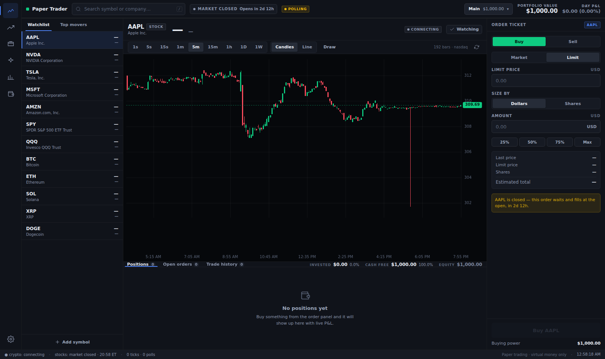
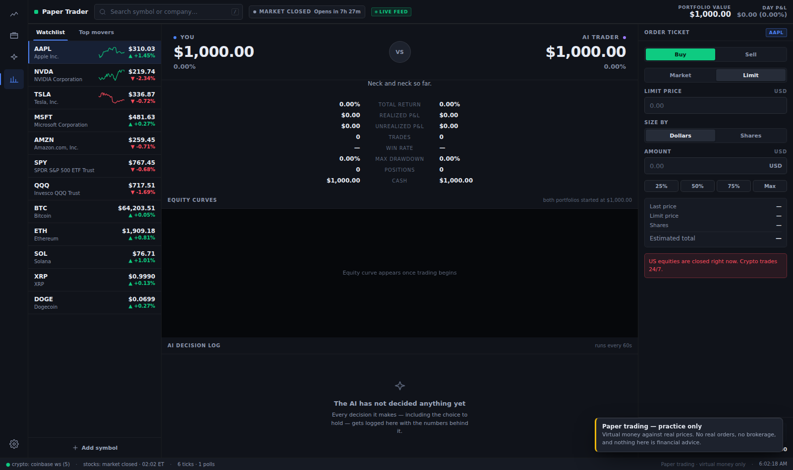
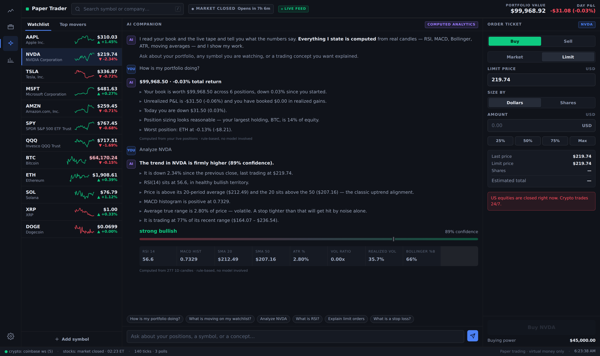

# Paper Trader

A self-contained paper trading terminal. Virtual money, real live market data,
stocks and crypto, in an interface built to feel like a real trading platform.



---

## How to run

You need [Node.js](https://nodejs.org) 18 or newer. Nothing else — there are no
dependencies to install.

```bash
node paper-trader.mjs
```

Then open **http://127.0.0.1:7777**.

That's it. On first launch it asks you to pick a starting balance; after that
your portfolio, cash and full trade history persist in your browser between
sessions.

```bash
PORT=8080 node paper-trader.mjs     # if 7777 is taken
```

To stop it, press `Ctrl+C`.

### Why there's a server at all

The app is one file, but it is not a plain `.html` you can double-click. The
free, key-less sources of US equity data — Yahoo Finance and Nasdaq — send no
CORS headers, so a browser cannot call them directly. The Node process exists to
proxy those requests, and while it's there it also caches them, coalesces
duplicates and rate-limits them so a busy watchlist can't get your IP throttled.

Crypto needs none of that: the browser streams it straight from Coinbase's
public WebSocket.

No account data ever reaches the server process. Your portfolio lives entirely
in your browser's `localStorage`.

---

## What it does

### Portfolio
- Pick a starting balance on first launch — $1K, $10K, $100K, $1M or your own number.
- Cash, positions, open orders, trade history and both equity curves persist between sessions.
- **Reset Portfolio** in Settings wipes everything and starts over (with a confirmation step).

### What you can trade
The curated list is a starting point, not a limit. **Every US-listed stock and
ETF is tradable** — around 7,000 names, penny stocks included — plus every coin
Coinbase carries (~400). Search finds anything; selecting it makes it tradable,
chartable and watchable immediately, and it is remembered across sessions.

The one gap: OTC / pink-sheet tickers are not in the listing directory, so a few
very small names won't resolve.

### Trading
- **Market and limit orders**, buy and sell, on stocks, ETFs and crypto.
- **Short selling.** Sell more than you own to bet on a fall. Shorts hold 150%
  of their value as collateral (Reg T, so about 2x leverage), the proceeds
  cannot be spent twice, and if equity drops below 30% of the short you get a
  margin call — below 25% it is bought back automatically, as a broker would.
  Turn it off in Settings if you'd rather stay long-only.
- **Fractional quantities** — size by dollars or by shares/coins. 8 decimals for crypto, 6 for equities.
- Limit orders rest on a book and fill when the live price crosses them, with
  price improvement. Resting orders reserve their cash or shares, so you cannot
  commit the same balance twice and have an order quietly vanish later.
- A simulated spread (2bp equities, 5bp crypto) is applied to market fills so an
  instant round trip costs you something, the way a real one does. You can turn
  it off in Settings.
- Positions show quantity, weighted-average cost, market value, and unrealized
  and realized P&L in both dollars and percent.
- Day P&L, total return, win rate, profit factor and max drawdown.
- Full timestamped trade history, plus anything that reached its price but
  could not fill, with the reason why.
- A permanent money bar above the blotter: how much is invested, how much cash
  is free to spend, what is reserved, and each position's share of the book.
- **Repair account** in Settings rebuilds cash and positions exactly from your
  trade history if anything ever looks wrong.

Shorting is modelled with real margin mechanics — collateral, a maintenance
level and a forced buy-in — because a short that can't lose more than it cost
would teach the wrong lesson. Borrow fees are the one thing not simulated.

### Market data
| What | Source | Notes |
|---|---|---|
| Crypto, live | Coinbase Exchange WebSocket | Real trade prints, straight to the browser |
| Crypto, snapshot + fallback | Coinbase REST (bulk) | All 517 products in one call |
| Crypto candles | Coinbase Exchange | Falls back to Yahoo |
| Stock quotes | Yahoo Finance v8 | Falls back to Nasdaq |
| Stock candles | Yahoo Finance v8 | Falls back to Nasdaq intraday + historical |
| Symbol search | Nasdaq listing directory (~7,000 names) | Coinbase products, then Yahoo |
| Ideas / screens | Nasdaq screener + Coinbase 24h stats | — |

Every quote is labelled with where it came from and how fresh it is —
**LIVE**, **DELAYED**, **CACHED** or **STALE**. Nothing is ever invented: if a
price is unavailable, the app says so rather than showing a plausible number.
Market hours are enforced for equities (including real NYSE holiday rules and
early closes) while crypto trades 24/7.

**Update rate.** Crypto is a true stream — every trade print, several per
second. Equities are polled, because Yahoo bans an IP for minutes after a burst
(see the note at the bottom): the symbol you are looking at refreshes every 1.5
seconds while the market is open, the rest of the watchlist every 6, and far
more slowly once the market shuts, when nothing is moving anyway. The app never
interpolates between real quotes — a price on screen is a price that traded.

### Charts
Candlestick and line charts drawn on raw canvas — no charting library.
Timeframes from **1 second** to 1 week, volume bars, a snapping crosshair with
an OHLCV readout, and a live last-price line that updates as the tape moves.

No public feed serves sub-minute candles — Coinbase's smallest granularity is
60 seconds — so the 1s/5s/15s views are built here from the live tick stream:
real trade prints for crypto, polled quotes for stocks. They fill in as ticks
arrive, and the chart labels the source as "live ticks" rather than pretending
it fetched them.

### Ideas
A board of live screens across the whole market: top gainers and fallers, most
actively traded, penny stocks on the move, large and steady names, biggest
companies, small caps making moves, and crypto movers. Each list states the
filter it applied — "top gainer" means little if you can't see whether
penny-stock noise was screened out. Click any card to start trading it.

These are screens, not recommendations.

### AI companion
An analyst panel that answers questions about your book, any symbol, or a
trading concept.

**By default every answer is computed, not generated.** It calculates RSI(14),
MACD(12,26,9), Bollinger Bands, ATR(14), moving averages, volume ratio, realised
volatility and range position from real candles, turns them into a weighted
stance with a confidence score, and cites the actual numbers back to you. It is
labelled "Computed analytics" in the UI precisely so it is never mistaken for
something it isn't.

If you want prose on top of the arithmetic, start the server with an Anthropic
API key:

```bash
ANTHROPIC_API_KEY=sk-ant-... node paper-trader.mjs
```

The model is then given the *computed evidence* and told it may not invent a
number. The key stays on your machine; the browser never sees it. Answers that
came from the model are labelled as such.

### Autonomous AI trader
A second portfolio, same starting cash, traded automatically every five seconds
by a deterministic multi-factor strategy while you trade yours. It stays
long-only regardless of your own shorting setting — its rules were designed and
tested without shorts.

It logs **every** decision — including the decision to do nothing — with the
factors behind it, so you can see exactly why it acted. Repeated identical holds
collapse into one entry with a count, so the log moves quickly without burying
the actual trades. It runs with real
guardrails: long only, max 8 positions, max 15% of equity per position, a 10%
cash floor, ATR-based stops and targets, a 10-minute per-symbol cooldown and a
25-trade daily cap.

The **You vs AI** tab is a live scoreboard: overlaid equity curves, total
return, realized and unrealized P&L, trade count, win rate and max drawdown.





---

## Keyboard shortcuts

| Key | Action |
|---|---|
| `/` | Focus the symbol search |
| `1`–`9` | Timeframe: 1s, 5s, 15s, 1m, 5m, 15m, 1h, 1D, 1W |
| `b` / `s` | Buy / sell side |
| `t` `g` `a` `c` | Trade · Portfolio · AI · Compare (Ideas is on the rail) |
| `Esc` | Close a dialog |

---

## Development

The shipped `paper-trader.mjs` is generated. Edit the sources under `src/`.

```bash
npm run dev      # serve from src/, re-read on every reload
npm run build    # regenerate paper-trader.mjs
npm test         # all suites
```

```
src/
  http.mjs         zero-dependency HTTPS client (handles CONNECT proxies)
  universe.mjs     the tradable asset list — single source of truth
  providers.mjs    upstream data, caching, failover, rate limiting
  server.mjs       static serving + the data proxy
  app/
    index.html     shell (CSS and JS are inlined at build time)
    css/           design tokens, layout, components, views
    js/            calendar, engine, indicators, feed, charts, AI, UI, views
tools/
  build.mjs        bundles everything into paper-trader.mjs
  serve.sh         start/stop helper used by the tests
test/              unit, live-data and browser suites
```

### Tests

365 assertions across 10 suites:

| Suite | What it covers |
|---|---|
| `calendar` | NYSE holiday rules, early closes, session phases, DST boundaries |
| `engine` | Order validation, cost basis, long and short P&L, margin and forced buy-in, limit fills, reserved balances, account repair, persistence, randomised float-safety runs |
| `indicators` | RSI/MACD/Bollinger/ATR against an independent reference implementation |
| `chart` | Axis tick generation, decimal precision, sparkline geometry |
| `feed` | Folding live ticks into session-anchored candles, freshness grading |
| `ai` | Companion output, trader entries/exits/risk limits, a 400-cycle simulation |
| `live-feed` | Connects to the **real** Coinbase socket and parses genuine live frames |
| `providers` | Rate-limiter behaviour under concurrency, freshness labelling |
| `browser` | Full end-to-end in Chromium against live data — 98 checks |
| `market-open` | The equity path with the session clock pinned open |

```bash
npm test                       # everything
PT_SKIP_BROWSER=1 npm test     # unit + live data only
PT_SHOTS=1 npm test            # also regenerate the screenshots in this README
```

The browser suite drives the real UI: onboarding, live quotes, chart rendering
on canvas, order placement and rejection, limit resting and cancelling,
persistence across reload, the companion, the AI trader, responsive layout and
reset. `market-open` exists because the suite usually runs outside trading
hours, which would otherwise leave the entire stock path untested.

---

## A note on rate limits

Yahoo Finance bans an IP for several minutes after a burst of requests, and
retrying during the penalty extends it. The app is built around that: it calls
Yahoo through a per-host token bucket (`query1` and `query2` are throttled
independently), backs off exponentially on a 429, caches aggressively, and polls
far less often when the market is closed. If Yahoo is unavailable it falls
through to Nasdaq and labels the data `DELAYED` rather than pretending.

You will see this working if you ever notice a **DELAYED** badge — it means the
number is real but came from the fallback.

---

## Disclaimer

**This is paper trading for practice only.** No real money is involved, no
orders reach a real market, and there is no brokerage account behind any of it.
Prices are real (live or delayed, as labelled), but everything you do here is a
simulation.

Nothing in this app is financial advice.
